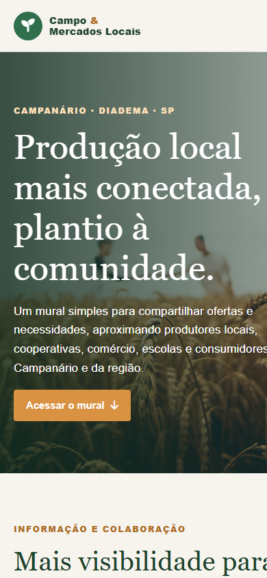
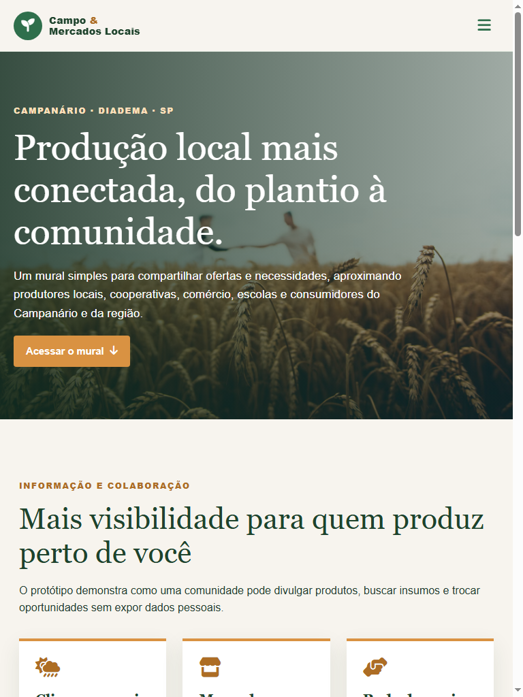
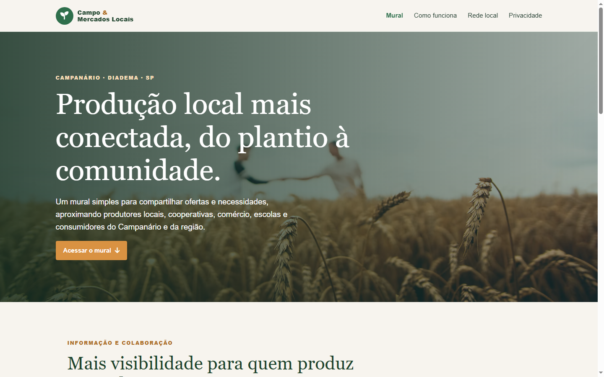

# P2 — Campo e Mercados Locais

Protótipo acadêmico de Tecnologia Cidadã para aproximar pequenos produtores e a comunidade local.

## Objetivo e público

O mural permite demonstrar a publicação e organização de ofertas e necessidades relacionadas à produção local. O público principal são pequenos produtores; cooperativas, comércio, escolas e consumidores podem participar da rede. O território definido para validação é o Campanário, em Diadema (SP).

O problema de acesso a informação e canais de venda é a hipótese que orienta o protótipo. A equipe ainda não coletou evidência local; isso precisa ser validado antes da entrega final, sem inventar entrevistas ou dados.

ODS relacionados:

- **ODS 2 — Fome zero e agricultura sustentável:** apoio à agricultura familiar e aos sistemas sustentáveis de produção de alimentos.
- **ODS 10 — Redução das desigualdades:** ampliar o acesso de produtores locais a informação e oportunidades.

## Tecnologias

- HTML5 semântico, CSS3 Mobile First e JavaScript.
- Bootstrap 5.3 para o grid e os cards da página inicial.
- Font Awesome 6.5 para ícones.
- Git e GitHub.

## Executar

1. Clone ou baixe este repositório.
2. Abra a pasta no VS Code.
3. Execute `Home.html` com a extensão Live Server (ou abra o arquivo no navegador).
4. Use **informações fictícias** para testar o mural.

Bootstrap, Font Awesome e a imagem de fundo do hero são carregados de CDNs. O restante do protótipo funciona sem servidor próprio.

## Estrutura

```text
.
├── Home.html            # Apresentação e mural CRUD
├── somos.html           # Proposta, fluxo e sustentabilidade de impacto
├── profissionais.html   # Atores que podem compor a rede local
├── contatos.html        # Privacidade, ameaças e limitações
├── style.css            # Estilos Mobile First e media queries
├── script.js            # Validação, CRUD no DOM e painel de atividades
├── docs/
│   ├── relatorio.html   # Relatório em formato pronto para impressão em PDF
│   ├── relatorio.pdf    # Relatório de até 3 páginas
│   └── prints/          # Capturas de telas para o README
└── README.md
```

## Mural e modelo de dados

O formulário principal demonstra as operações de **adicionar, listar, editar e remover**. Os registros são mantidos apenas em memória durante a sessão do navegador; recarregar a página apaga os dados.

Cada registro contém:

| Campo | Descrição |
|---|---|
| `id` | Identificador local sequencial |
| `tipo` | `Oferta` ou `Procura` |
| `item` | Produto, serviço ou necessidade (2–60 caracteres) |
| `cidade` | Município ou região (2–50 caracteres) |
| `detalhes` | Texto opcional (até 240 caracteres) |

O painel de atividades registra data/hora, ação e resultado. O protótipo não coleta dados pessoais, não transmite registros e não representa um canal real de negociação.

## Segurança e privacidade

- Campos obrigatórios usam validação nativa HTML5 e validação adicional em JavaScript.
- Entradas são limitadas por tamanho e não são interpretadas como HTML.
- Mensagens de erro exibidas não revelam detalhes técnicos.
- O formulário pede apenas informações necessárias para demonstrar uma publicação; não inclua dados pessoais ou comerciais confidenciais.
- O protótipo não tem backend, autenticação, persistência, moderação ou negociação.

## Validação

Testes executados no navegador:

- Celular (390 × 844), tablet (768 × 1024) e desktop (1440 × 900): sem rolagem horizontal; navegação mobile abre e navegação desktop fica visível.
- CRUD: item de teste adicionado, editado, listado e removido; painel registrou data/hora, ação e resultado.
- Campo obrigatório vazio, texto só com espaços e tentativa de inserir marcação são rejeitados. O limite HTML de 60 caracteres no item foi aplicado; limites e formato também são verificados no JavaScript.
- As publicações são mantidas somente em memória; recarregar limpa o mural.

Capturas:





Relatório: [PDF](docs/relatorio.pdf) · [fonte HTML](docs/relatorio.html). A evidência local permanece pendente porque a equipe ainda não escolheu região nem coletou conversa, observação ou dado público.

## Sustentabilidade como negócio de impacto

Uma possibilidade a validar é manter o mural básico gratuito e financiar suporte, capacitação e expansão por meio de parcerias com cooperativas, associações, governos locais e editais de impacto. A implantação deve começar em uma comunidade, medir utilidade e custos e crescer conforme a capacidade de suporte, sem comercializar dados pessoais.

## Créditos e referências de terceiros

- Bootstrap: https://getbootstrap.com/ (CSS do grid e componentes).
- Font Awesome Free: https://fontawesome.com/ (ícones).
- Imagem de fundo: Unsplash, https://images.unsplash.com/photo-1500937386664-56d1dfef3854 (carregada por URL no CSS).
- O conteúdo e o código de interação do protótipo foram produzidos para esta atividade.

## IA

Este protótipo foi desenvolvido com apoio de uma ferramenta de IA para adaptar o código-base, implementar a interação e preparar a documentação. A equipe deve revisar e validar o conteúdo antes da entrega.
